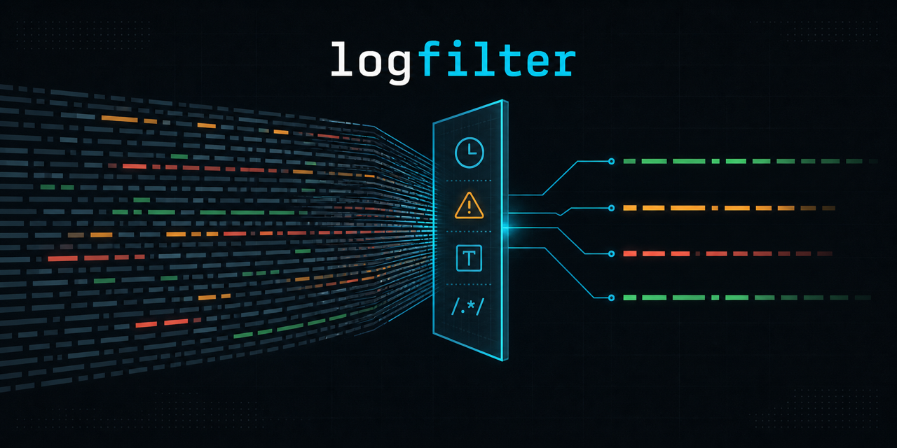

# logfilter

[English](./README.md) | 日本語

[](https://github.com/scenario-test-framework/logfilter/actions/workflows/ci.yaml)
[](https://github.com/scenario-test-framework/logfilter/releases/latest)
[](./go.mod)
[](https://github.com/scenario-test-framework/logfilter/pkgs/container/logfilter)
[](./LICENSE)



## 概要

大容量のログファイルから、期間やログレベル、文言を指定して、必要なログイベントを抽出するCUIツールです。

Go 製の単一バイナリで動作します (旧 Java 実装から CLI 互換でリライト)。


## 機能

### ログファイルのフィルタリング

指定のログフォーマットで出力されているログファイルから
期間、ログレベル、文字列、正規表現 を指定して、マッチするログイベントだけのファイルを作成します。

既定のテキスト形式では、タイムスタンプで始まらない行 (スタックトレースなど) を直前のログイベントの継続行として扱います。JSON Lines と logfmt では、指定したフィールドからタイムスタンプとログレベルを読み取れます。

* 対応しているログフォーマット
    * apache access log形式
        * サンプル

            ```
            127.0.0.1 - name [10/Oct/2000:13:55:36 +0900] "GET /apache_pb.gif HTTP/1.0" 200 2326
            ```

    * 「タイムスタンプ ログレベル メッセージ」形式
        * タイムスタンプ
            * 日付
                * 「yyyy/MM/dd」, 「yy/MM/dd」
                * 「yyyy-MM-dd」, 「yy-MM-dd」
                * 「yyyyMMdd」
            * 日付時刻セパレータ
                * 「 （半角スペース）」
                * 「T」
            * 時刻
                * 「なし」
                * 「HH:mm」, 「HH:mm:ss」
                * 「HH:mm:ss.SSS」, 「HH:mm:ss,SSS」
        * タイムゾーン
            * `T` 区切りの ISO 形式では「Z」「+09」「+0900」「+09:00」に対応
            * Apache access log 形式では数値オフセットに対応
            * 半角スペース区切りの日時はローカルタイムとして解釈
        * ログレベル
            * 前提
                * タイムスタンプとの区切りが「半角スペース」
                * ログレベルを「半角スペース」か「大カッコ」でくくっている
            * 形式
                * 任意（TRACE～ERROR、FINEST〜FATAL etc）
        * サンプル

            ```
            2016-11-06 12:17:53.985 DEBUG 15765 [      main] m.s.t.l.i.p.BaseLayerSuperType : START validate
            2016-11-06 12:17:54.022 DEBUG 15765 [      main] m.s.t.l.i.p.BaseLayerSuperType : END   validate
            2016-11-06 12:17:54.022 ERROR 15765 [      main] m.s.t.l.s.LogFilterServiceTest : [error.validate]妥当性チェックエラーが発生しました。
            LogFilterServiceInput.timeFilterValueFrom:日時に変換できません。 設定値=unmatched date format
            LogFilterServiceInput.outputCharset:サポートされていない文字コードです。 設定値=NotExist2
            LogFilterServiceInput.inputCharset:サポートされていない文字コードです。 設定値=NotExist
            LogFilterServiceInput.inputFilePath:存在しないパスです。 設定値=/path/to/input
            ```

    * 構造化ログ形式 (JSON Lines / logfmt)
        * JSON Lines は `-lf json`、logfmt は `-lf logfmt` で指定します。

* 対応している文字コード
    * UTF-8 / Shift_JIS (CP932) / EUC-JP / ISO-2022-JP / UTF-16 と、それぞれの別名 (`utf8`, `sjis`, `MS932` など)

### 構造化ログ (JSON Lines / logfmt)

同じイベントを JSON Lines と logfmt で表すと、次のようになります。

```json
{"time":"2024-01-01T00:00:01Z","level":"warn","msg":"retry stopped"}
```

```text
time=2024-01-01T00:00:01Z level=warn msg="retry stopped"
```

JSON Lines では1行に1つの JSON オブジェクトを書きます。logfmt ではフィールドを空白で区切ります。ダブルクォートで囲んだ値は空白とエスケープ (`\"`、`\\`、`\n`、`\r`、`\t`) を含められます。引用符なしの値に `=` や `"` を含む行は解析できない行 (継続行) になります。`key=` は空の値を表します。`=` の無い単独の `key` は無視するため、平文の継続行に含まれる `time` のような単語をフィールドと誤認しません。

- **タイムスタンプのキー**は `time`、`timestamp`、`ts`、`@timestamp` の順に探し、最初に存在したものを使います。`-tk` を指定すると、そのキーだけを使います。たとえば `-tk log.ts` は、JSON ではまず `log.ts` という名前のキーを探し、次に `log` オブジェクト内の `ts` を探します。各階層で残りのパス全体と一致するキーを優先し、その後に短い接頭辞から順にオブジェクトをたどります。logfmt ではドットもキー名の一部です。`-lk` の指定も同じ規則です。
- **日時形式**の既定値は `auto` です。数字だけの文字列 (先頭の `-` と小数部を含んでよい) は Unix 時刻として扱います。ただし8桁の整数の文字列が暦日として正しければ `yyyyMMdd` と解釈し、たとえば `"20240101"` はローカルタイムの2024年1月1日になります。`"20240230"` のように暦日として正しくない8桁の文字列は Unix 秒として扱います。それ以外の文字列は対応する日時形式で解釈します。JSON 数値は Unix 時刻として扱います。整数部の絶対値が `1e11` 未満なら秒、`1e14` 未満ならミリ秒、`1e17` 未満ならマイクロ秒、それ以上ならナノ秒です。`-tfmt` に `unix`、`unixms`、`unixus`、`unixns` を指定すると、8桁の文字列も含めて単位を固定できます。いずれも小数に対応し、ナノ秒までの精度を保持します。0001〜9999年の範囲外になる Unix 時刻は変換できない値として扱います。
- **イベントの区切り**は、有効なタイムスタンプを持つ行です。解析できない行、JSON オブジェクト以外の行、指定のキーを含まない行は、直前のイベントの継続行になります。1行目にはイベントの先頭行が必要です。キーが存在しても値を日時に変換できない場合は、行番号と値を表示して終了コード `6` で停止します。出力は各行の元の表記を保ちます。文字列・正規表現フィルタは継続行を含むイベント全文が対象です。
- **ログレベル**はイベントの先頭行で `level`、`severity`、`lvl` の順に最初に存在するキー、または `-lk` で指定したキーから取得します。値が文字列または数値なら、大文字小文字を区別せずに `-l` の各指定値と完全一致で比較します。キーがない場合や値がそれ以外の型の場合は、従来どおりイベント全文で ` LEVEL ` または `[LEVEL` を大文字小文字を区別して検索します。Docker の json-file 形式でも `log` 内に書かれたレベルをこの方法で抽出できます。

## インストール

* GitHub Releases からお使いのプラットフォームのアーカイブをダウンロードして展開

    ``` sh
    tar xvfz ./logfilter_*.tar.gz
    mv ./logfilter_*/logfilter /usr/local/bin/
    ```

* または Go でビルド

    ``` sh
    go install github.com/scenario-test-framework/logfilter@latest
    ```

* または Docker で実行 (インストール不要)

    ``` sh
    docker pull ghcr.io/scenario-test-framework/logfilter:latest
    ```


## 使い方

``` sh
logfilter [OPTION] inputFilePath [outputFilePath]
```

``` sh
# ヘルプ
logfilter -h

# 期間で抽出
logfilter -tf '2016-11-06 12:17:53.000' -tt '2016-11-06 12:18:00.000' ./app.log ./filtered.log

# ログレベルで抽出
logfilter -l 'WARN,ERROR' ./app.log ./filtered.log

# logfmt の既定のキーで WARN を抽出
logfilter -lf logfmt -l WARN ./app.logfmt ./filtered.log

# JSON Lines 内のネストした Unix ミリ秒とログレベルを使用
logfilter -lf json -tk log.ts -tfmt unixms -lk log.level -l ERROR ./app.jsonl ./filtered.jsonl

# 文字列・正規表現で抽出
logfilter -s 'Exception' ./app.log ./filtered.log
logfilter -r 'ERROR|Exception' ./app.log ./filtered.log

# 設定ファイル + コマンドオプションで上書き
logfilter -cf ./config.json -tf '2016-11-06' ./app.log ./filtered.log
```

### オプション

| オプション | 説明 |
|---|---|
| `-h`, `--help` | usage を表示します。 |
| `-f`, `--force` | 出力ファイルパスが存在する場合の確認を表示しません。 |
| `-cf`, `--configFile` | 設定ファイル (JSON) のパスを指定します。 |
| `-ic`, `--inputCharset` | 入力ファイルの文字コード。デフォルトは UTF-8。 |
| `-oc`, `--outputCharset` | 出力ファイルの文字コード。デフォルトは入力と同じ。 |
| `-lf`, `--logFormat` | 入力ログの形式。`text` (既定)、`json` (JSON Lines)、`logfmt`。 |
| `-tk`, `--timestampKey` | 構造化ログのタイムスタンプキー。省略時は既定候補を順に探索。 |
| `-tfmt`, `--timestampFormat` | 構造化ログの日時形式。`auto` (既定)、`unix`、`unixms`、`unixus`、`unixns`。 |
| `-lk`, `--logLevelKey` | 構造化ログのレベルキー。省略時は既定候補を順に探索。 |
| `-tf`, `--timeFilterFrom` | 抽出を開始する時刻 (この時刻を含む)。 |
| `-tt`, `--timeFilterTo` | 抽出を終了する時刻 (この時刻を含まない)。 |
| `-l`, `--logLevelFilter` | 抽出するログレベル (カンマ区切り)。 |
| `-s`, `--stringContentFilter` | 抽出する文字列 (部分一致)。 |
| `-r`, `--regexFilter` | 抽出する正規表現 ([RE2構文](https://github.com/google/re2/wiki/Syntax))。 |

### 設定ファイル

``` json
{
    "inputCharset": "UTF-8",
    "outputFilePath": "",
    "outputCharset": "",
    "timeFilterValueFrom": "",
    "timeFilterValueTo": "",
    "logLevelFilterValueList": ["WARN", "ERROR"],
    "stringContentFilterValue": "",
    "regexFilterValue": ""
}
```

* 入力ファイルパスは常にコマンドの位置引数で指定します (設定ファイルでは指定できません)。
* 出力ファイルパスは、位置引数を省略した場合に設定ファイルの `outputFilePath` が使用されます。

`{"log":{"ts":1704067200123,"level":"error"}}` のような JSON Lines には、次の設定を使えます。`timestampKey`、`timestampFormat`、`logLevelKey` は `json` または `logfmt` のときだけ指定できます。空でないコマンドラインオプションは、対応する設定ファイルの値を上書きします。

```json
{
    "logFormat": "json",
    "timestampKey": "log.ts",
    "timestampFormat": "unixms",
    "logLevelKey": "log.level",
    "logLevelFilterValueList": ["ERROR"]
}
```

### リターンコード

| コード | 意味 |
|---|---|
| 0 | 正常終了 |
| 3 | 警告終了 (フィルタにマッチするログイベントなし) |
| 6 | エラー終了 |

### Docker で実行

``` sh
# カレントディレクトリのログをフィルタリング
docker run --rm \
    -u "$(id -u):$(id -g)" \
    -e TZ=Asia/Tokyo \
    -v "$PWD:/work" \
    ghcr.io/scenario-test-framework/logfilter:latest \
    -l 'WARN,ERROR' /work/app.log /work/filtered.log
```

* `-e TZ=...` : タイムゾーンなしのタイムスタンプ (`yyyy-MM-dd HH:mm:ss` 等) の解釈に使用します。未指定の場合は UTC として解釈されます。
* `-u "$(id -u):$(id -g)"` : 出力ファイルの所有者をホストの実行ユーザーに合わせます。

docker compose の場合 ([compose.yaml](./compose.yaml)):

``` sh
docker compose run --rm logfilter -l 'WARN,ERROR' /work/logs/app.log /work/logs/filtered.log
```


## Tips

1. 設定をまとめたファイルを指定＋コマンドで上書きして実行することができます。
下記のように、ルーティン作業を簡素化することも可能です。
    * 設定ファイルで ログレベル：WARN以上 に絞る設定をしておき、コマンドで対象ログファイルを指定する
    * 設定ファイルで 出力先や文字コード を指定しておき、コマンドで期間を今日に絞る

1. 特定の絞り込み条件を指定したコマンドをalias登録しておき、パスだけ指定して動かすこともできます。


## 開発

``` sh
make        # vet + test + build
make cross  # 配布用クロスコンパイル (dist/)
```

* 前提: Go 1.26+

### CI/CD

| ワークフロー | トリガー | 内容 |
|---|---|---|
| [CI](./.github/workflows/ci.yaml) | push / pull_request | vet + test + build + docker build 検証 |
| [Release](./.github/workflows/release.yaml) | `v*` タグ push | 配布アーカイブを GitHub Releases に添付 + マルチアーチイメージ (amd64/arm64) を GHCR に公開 |

リリース手順:

``` sh
git tag v2.0.0
git push origin v2.0.0
```
